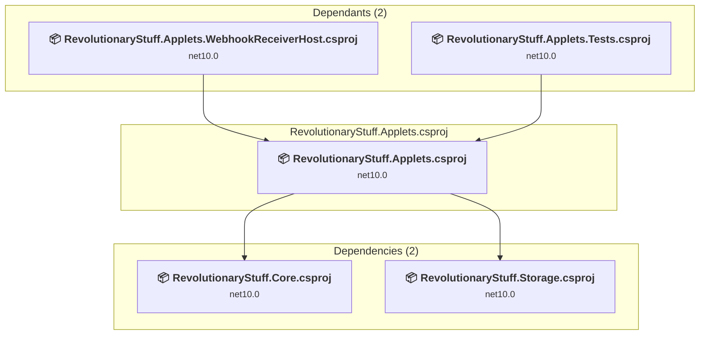

# src\RevolutionaryStuff.Applets\RevolutionaryStuff.Applets.csproj

[← Back to the assessment index](../../assessment.md)

## Project Info

- **Current Target Framework:** net10.0
- **Proposed Target Framework:** net11.0
- **SDK-style**: True
- **Project Kind:** ClassLibrary
- **Dependencies**: 2
- **Dependants**: 2
- **Number of Files**: 17
- **Number of Files with Incidents**: 1
- **Lines of Code**: 474
- **Estimated LOC to modify**: 0+ (at least 0.0% of the project)

## Related Projects

**Depends on (2)** — projects this one references:

- [C:\src\jbt00000\RevolutionaryStuff\src\RevolutionaryStuff.Core\RevolutionaryStuff.Core.csproj](../projects/RevolutionaryStuff.Core.md)
- [C:\src\jbt00000\RevolutionaryStuff\src\RevolutionaryStuff.Storage\RevolutionaryStuff.Storage.csproj](../projects/RevolutionaryStuff.Storage.md)

**Depended on by (2)** — projects that reference this one:

- [C:\src\jbt00000\RevolutionaryStuff\src\RevolutionaryStuff.Applets.WebhookReceiverHost\RevolutionaryStuff.Applets.WebhookReceiverHost.csproj](../projects/RevolutionaryStuff.Applets.WebhookReceiverHost.md)
- [C:\src\jbt00000\RevolutionaryStuff\tests\RevolutionaryStuff.Applets.Tests\RevolutionaryStuff.Applets.Tests.csproj](../projects/RevolutionaryStuff.Applets.Tests.md)

## Dependency Graph

Legend:
📦 SDK-style project
⚙️ Classic project

## API Compatibility

| Category | Count | Impact |
| :--- | :---: | :--- |
| 🔴 Binary Incompatible | 0 | High - Require code changes |
| 🟡 Source Incompatible | 0 | Medium - Needs re-compilation and potential conflicting API error fixing |
| 🔵 Behavioral change | 0 | Low - Behavioral changes that may require testing at runtime |
| ✅ Compatible | 343 |  |
| ***Total APIs Analyzed*** | ***343*** |  |

## NuGet Package Issues

| Package | Current Version | Suggested Version | Severity | Issue |
| :--- | :---: | :---: | :---: | :--- |
| Microsoft.Extensions.Hosting.Abstractions | 10.0.15 | 11.0.0 | 🟡 Potential | NuGet package upgrade is recommended |
| Microsoft.Extensions.Options.ConfigurationExtensions | 10.0.15 | 11.0.0 | 🟡 Potential | NuGet package upgrade is recommended |
| Microsoft.Extensions.Options.DataAnnotations | 10.0.15 | 11.0.0 | 🟡 Potential | NuGet package upgrade is recommended |

Every project affected by these packages, and the versions the repository settles on: [aggregate NuGet packages](../nuget/aggregate-packages.md).

