# src\RevolutionaryStuff.Core\RevolutionaryStuff.Core.csproj

[← Back to the assessment index](../../assessment.md)

## Project Info

- **Current Target Framework:** net10.0
- **Proposed Target Framework:** net11.0
- **SDK-style**: True
- **Project Kind:** ClassLibrary
- **Dependencies**: 0
- **Dependants**: 15
- **Number of Files**: 182
- **Number of Files with Incidents**: 30
- **Lines of Code**: 18001
- **Estimated LOC to modify**: 96+ (at least 0.5% of the project)

## Related Projects

**Depended on by (15)** — projects that reference this one:

- [C:\src\jbt00000\RevolutionaryStuff\src\RevolutionaryStuff.ApiCore\RevolutionaryStuff.ApiCore.csproj](../projects/RevolutionaryStuff.ApiCore.md)
- [C:\src\jbt00000\RevolutionaryStuff\src\RevolutionaryStuff.Applets\RevolutionaryStuff.Applets.csproj](../projects/RevolutionaryStuff.Applets.md)
- [C:\src\jbt00000\RevolutionaryStuff\src\RevolutionaryStuff.AspNetCore\RevolutionaryStuff.AspNetCore.csproj](../projects/RevolutionaryStuff.AspNetCore.md)
- [C:\src\jbt00000\RevolutionaryStuff\src\RevolutionaryStuff.Azure\RevolutionaryStuff.Azure.csproj](../projects/RevolutionaryStuff.Azure.md)
- [C:\src\jbt00000\RevolutionaryStuff\src\RevolutionaryStuff.BlazorWasm\RevolutionaryStuff.BlazorWasm.csproj](../projects/RevolutionaryStuff.BlazorWasm.md)
- [C:\src\jbt00000\RevolutionaryStuff\src\revolutionarystuff.com\revolutionarystuff.com.csproj](../projects/revolutionarystuff.com.md)
- [C:\src\jbt00000\RevolutionaryStuff\src\RevolutionaryStuff.Crm\RevolutionaryStuff.Crm.csproj](../projects/RevolutionaryStuff.Crm.md)
- [C:\src\jbt00000\RevolutionaryStuff\src\RevolutionaryStuff.Data.Cosmos\RevolutionaryStuff.Data.Cosmos.csproj](../projects/RevolutionaryStuff.Data.Cosmos.md)
- [C:\src\jbt00000\RevolutionaryStuff\src\RevolutionaryStuff.Data.JsonStore.Cosmos\RevolutionaryStuff.Data.JsonStore.Cosmos.csproj](../projects/RevolutionaryStuff.Data.JsonStore.Cosmos.md)
- [C:\src\jbt00000\RevolutionaryStuff\src\RevolutionaryStuff.Data.JsonStore\RevolutionaryStuff.Data.JsonStore.csproj](../projects/RevolutionaryStuff.Data.JsonStore.md)
- [C:\src\jbt00000\RevolutionaryStuff\src\RevolutionaryStuff.Data.SqlAzure\RevolutionaryStuff.Data.SqlAzure.csproj](../projects/RevolutionaryStuff.Data.SqlAzure.md)
- [C:\src\jbt00000\RevolutionaryStuff\src\RevolutionaryStuff.Maui\RevolutionaryStuff.Maui.csproj](../projects/RevolutionaryStuff.Maui.md)
- [C:\src\jbt00000\RevolutionaryStuff\src\RevolutionaryStuff.SqlServer\RevolutionaryStuff.Data.SqlServer.csproj](../projects/RevolutionaryStuff.Data.SqlServer.md)
- [C:\src\jbt00000\RevolutionaryStuff\src\RevolutionaryStuff.Storage\RevolutionaryStuff.Storage.csproj](../projects/RevolutionaryStuff.Storage.md)
- [C:\src\jbt00000\RevolutionaryStuff\tests\RevolutionaryStuff.Core.Tests\RevolutionaryStuff.Core.Tests.csproj](../projects/RevolutionaryStuff.Core.Tests.md)

## Dependency Graph

Legend:
📦 SDK-style project
⚙️ Classic project

```mermaid
flowchart TB
    subgraph upstream["Dependants (15)"]
        P1["<b>📦&nbsp;RevolutionaryStuff.ApiCore.csproj</b><br/><small>net10.0</small>"]
        P3["<b>📦&nbsp;RevolutionaryStuff.Applets.csproj</b><br/><small>net10.0</small>"]
        P4["<b>📦&nbsp;RevolutionaryStuff.AspNetCore.csproj</b><br/><small>net10.0</small>"]
        P5["<b>📦&nbsp;RevolutionaryStuff.Azure.csproj</b><br/><small>net10.0</small>"]
        P6["<b>📦&nbsp;RevolutionaryStuff.BlazorWasm.csproj</b><br/><small>net10.0</small>"]
        P7["<b>📦&nbsp;revolutionarystuff.com.csproj</b><br/><small>net10.0</small>"]
        P9["<b>📦&nbsp;RevolutionaryStuff.Crm.csproj</b><br/><small>net10.0</small>"]
        P11["<b>📦&nbsp;RevolutionaryStuff.Data.Cosmos.csproj</b><br/><small>net10.0</small>"]
        P12["<b>📦&nbsp;RevolutionaryStuff.Data.JsonStore.Cosmos.csproj</b><br/><small>net10.0</small>"]
        P13["<b>📦&nbsp;RevolutionaryStuff.Data.JsonStore.csproj</b><br/><small>net10.0</small>"]
        P14["<b>📦&nbsp;RevolutionaryStuff.Data.SqlAzure.csproj</b><br/><small>net10.0</small>"]
        P15["<b>📦&nbsp;RevolutionaryStuff.Maui.csproj</b><br/><small>net10.0-android;net10.0-ios;net10.0-maccatalyst;net10.0-windows10.0.19041.0</small>"]
        P16["<b>📦&nbsp;RevolutionaryStuff.Data.SqlServer.csproj</b><br/><small>net10.0</small>"]
        P19["<b>📦&nbsp;RevolutionaryStuff.Storage.csproj</b><br/><small>net10.0</small>"]
        P20["<b>📦&nbsp;RevolutionaryStuff.Core.Tests.csproj</b><br/><small>net10.0</small>"]
        click P1 "../projects/RevolutionaryStuff.ApiCore.md"
        click P3 "../projects/RevolutionaryStuff.Applets.md"
        click P4 "../projects/RevolutionaryStuff.AspNetCore.md"
        click P5 "../projects/RevolutionaryStuff.Azure.md"
        click P6 "../projects/RevolutionaryStuff.BlazorWasm.md"
        click P7 "../projects/revolutionarystuff.com.md"
        click P9 "../projects/RevolutionaryStuff.Crm.md"
        click P11 "../projects/RevolutionaryStuff.Data.Cosmos.md"
        click P12 "../projects/RevolutionaryStuff.Data.JsonStore.Cosmos.md"
        click P13 "../projects/RevolutionaryStuff.Data.JsonStore.md"
        click P14 "../projects/RevolutionaryStuff.Data.SqlAzure.md"
        click P15 "../projects/RevolutionaryStuff.Maui.md"
        click P16 "../projects/RevolutionaryStuff.Data.SqlServer.md"
        click P19 "../projects/RevolutionaryStuff.Storage.md"
        click P20 "../projects/RevolutionaryStuff.Core.Tests.md"
    end
    subgraph current["RevolutionaryStuff.Core.csproj"]
        MAIN["<b>📦&nbsp;RevolutionaryStuff.Core.csproj</b><br/><small>net10.0</small>"]
        click MAIN "../projects/RevolutionaryStuff.Core.md"
    end
    P1 --> MAIN
    P3 --> MAIN
    P4 --> MAIN
    P5 --> MAIN
    P6 --> MAIN
    P7 --> MAIN
    P9 --> MAIN
    P11 --> MAIN
    P12 --> MAIN
    P13 --> MAIN
    P14 --> MAIN
    P15 --> MAIN
    P16 --> MAIN
    P19 --> MAIN
    P20 --> MAIN

```

## API Compatibility

| Category | Count | Impact |
| :--- | :---: | :--- |
| 🔴 Binary Incompatible | 0 | High - Require code changes |
| 🟡 Source Incompatible | 26 | Medium - Needs re-compilation and potential conflicting API error fixing |
| 🔵 Behavioral change | 70 | Low - Behavioral changes that may require testing at runtime |
| ✅ Compatible | 14688 |  |
| ***Total APIs Analyzed*** | ***14784*** |  |

## NuGet Package Issues

| Package | Current Version | Suggested Version | Severity | Issue |
| :--- | :---: | :---: | :---: | :--- |
| Microsoft.Extensions.Configuration.EnvironmentVariables | 10.0.15 | 11.0.0 | 🟡 Potential | NuGet package upgrade is recommended |
| Microsoft.Extensions.Configuration.Json | 10.0.15 | 11.0.0 | 🟡 Potential | NuGet package upgrade is recommended |
| Microsoft.Extensions.Configuration.UserSecrets | 10.0.15 | 11.0.0 | 🟡 Potential | NuGet package upgrade is recommended |
| Microsoft.Extensions.Hosting.Abstractions | 10.0.15 | 11.0.0 | 🟡 Potential | NuGet package upgrade is recommended |
| Microsoft.Extensions.Http | 10.0.15 | 11.0.0 | 🟡 Potential | NuGet package upgrade is recommended |
| Microsoft.Extensions.Logging.Console | 10.0.15 | 11.0.0 | 🟡 Potential | NuGet package upgrade is recommended |
| System.IO.Hashing | 10.0.15 | 11.0.0 | 🟡 Potential | NuGet package upgrade is recommended |

Every project affected by these packages, and the versions the repository settles on: [aggregate NuGet packages](../nuget/aggregate-packages.md).

