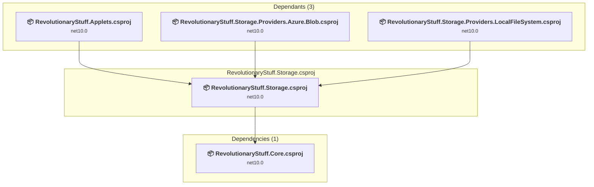

# src\RevolutionaryStuff.Storage\RevolutionaryStuff.Storage.csproj

[← Back to the assessment index](../../assessment.md)

## Project Info

- **Current Target Framework:** net10.0
- **Proposed Target Framework:** net11.0
- **SDK-style**: True
- **Project Kind:** ClassLibrary
- **Dependencies**: 1
- **Dependants**: 3
- **Number of Files**: 28
- **Number of Files with Incidents**: 3
- **Lines of Code**: 1055
- **Estimated LOC to modify**: 2+ (at least 0.2% of the project)

## Related Projects

**Depends on (1)** — projects this one references:

- [C:\src\jbt00000\RevolutionaryStuff\src\RevolutionaryStuff.Core\RevolutionaryStuff.Core.csproj](../projects/RevolutionaryStuff.Core.md)

**Depended on by (3)** — projects that reference this one:

- [C:\src\jbt00000\RevolutionaryStuff\src\RevolutionaryStuff.Applets\RevolutionaryStuff.Applets.csproj](../projects/RevolutionaryStuff.Applets.md)
- [C:\src\jbt00000\RevolutionaryStuff\src\RevolutionaryStuff.Storage.Providers.Azure.Blob\RevolutionaryStuff.Storage.Providers.Azure.Blob.csproj](../projects/RevolutionaryStuff.Storage.Providers.Azure.Blob.md)
- [C:\src\jbt00000\RevolutionaryStuff\src\RevolutionaryStuff.Storage.Providers.LocalFileSystem\RevolutionaryStuff.Storage.Providers.LocalFileSystem.csproj](../projects/RevolutionaryStuff.Storage.Providers.LocalFileSystem.md)

## Dependency Graph

Legend:
📦 SDK-style project
⚙️ Classic project

## API Compatibility

| Category | Count | Impact |
| :--- | :---: | :--- |
| 🔴 Binary Incompatible | 0 | High - Require code changes |
| 🟡 Source Incompatible | 0 | Medium - Needs re-compilation and potential conflicting API error fixing |
| 🔵 Behavioral change | 2 | Low - Behavioral changes that may require testing at runtime |
| ✅ Compatible | 599 |  |
| ***Total APIs Analyzed*** | ***601*** |  |

